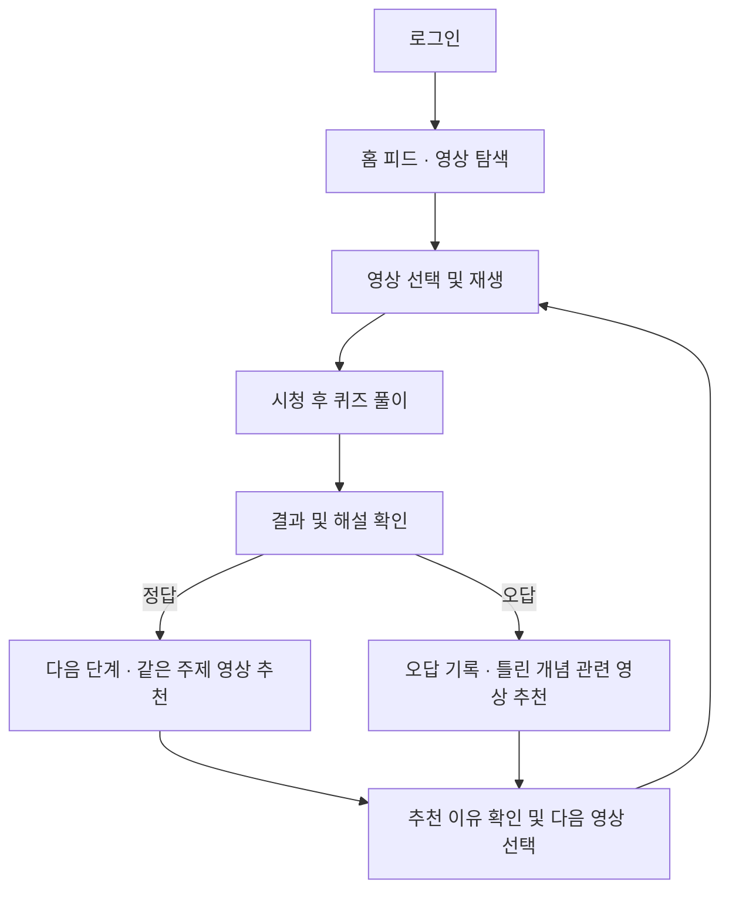
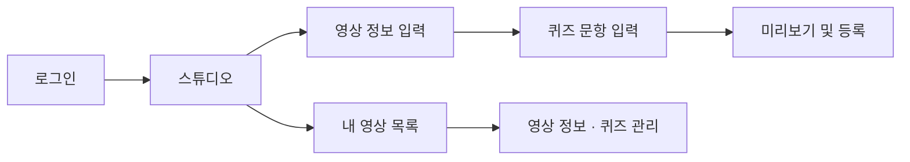
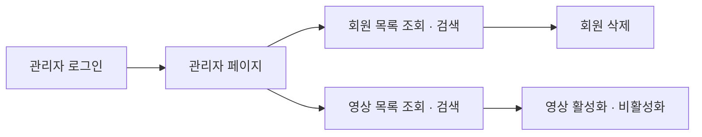

# edu_shortform

직장인과 취업 준비생을 위한 직무 교육 숏폼 플랫폼입니다.

더존비앤씨티 인턴십 2조에서 개발하고 있습니다. 기업·현직자·개인이 교육 영상을 등록하고, 사용자는 영상을 시청한 뒤 퀴즈를 풀며 학습합니다.

아래는 개발 예정 기능입니다.

## 주요 기능

| 영역 | 개발 목표 |
| --- | --- |
| 회원 | 회원가입·세션 로그인, 사용자·크리에이터 통합 계정 |
| 영상 탐색·시청 | 홈 피드, 카테고리별 탐색·검색, 영상 재생, 조회수·좋아요 |
| 콘텐츠 등록 | 스튜디오에서 영상 정보와 퀴즈 등록, 내 영상 관리 |
| 학습 | 영상별 퀴즈 풀이, 채점·해설, 오답 기록 |
| 영상 추천 | 퀴즈 결과에 따른 관련 영상·추천 이유 제공 (추후 구현) |
| 마이페이지 | 회원정보, 시청 기록, 좋아요한 영상, 오답 확인 |
| 관리자 | 회원 목록 조회·검색·삭제, 영상 목록 조회·검색·활성화·비활성화 |

사용자와 크리에이터는 하나의 회원 계정으로 시청과 콘텐츠 등록 기능을 이용합니다. 관리자는 별도 권한으로 회원과 영상을 관리합니다.

## 서비스 흐름

### 사용자



퀴즈와 오답 기록을 먼저 구현하고, 영상 추천은 이후에 추가할 예정입니다. 추천은 개념 태그·카테고리·퀴즈 결과를 기준으로 관련 영상 3~4개를 보여주는 방식으로 검토하고 있습니다.

마이페이지에는 시청 기록, 좋아요한 영상, 오답 목록을 표시할 예정입니다.

### 크리에이터



영상 등록 항목은 제목·설명·카테고리·개념 태그입니다. 영상 파일은 현재 로컬에 저장합니다. 퀴즈 등록 기능과 외부 저장소 연결은 추후 진행합니다.

### 관리자



관리자 페이지에서는 회원과 영상을 관리합니다. 회원은 조회·검색·삭제, 영상은 조회·검색·활성화·비활성화를 처리합니다.

## 기술 스택

| 구분 | 기술 |
| --- | --- |
| 프론트엔드 | React |
| 백엔드 | Java 17, Spring Boot 4.1.1 |
| 빌드 | Gradle |
| 데이터베이스 | MySQL |
| 인증 | Spring Security, 세션 방식 |
| API 문서 | Swagger UI, springdoc-openapi |
| 영상 저장 | 로컬 파일 저장 (외부 저장소는 추후 연결) |
| 실행 환경 | 로컬 |

## 개발 범위

- 기본 기능: 콘텐츠 등록·재생·조회수·좋아요
- 학습: 퀴즈 풀이·채점·해설·오답 기록
- 추후 구현: 퀴즈 결과에 따른 영상 추천
- 제외: 1·3·7일 복습 예약, 회원 활성화·비활성화
- 검토 중: 댓글·공유

## 팀 구성

| 이름 | 분야 |
| --- | --- |
| 김가빈 | 프론트엔드 |
| 이상규 | 프론트엔드 |
| 이준식 | 프론트엔드 |
| 박재성 | 백엔드 (콘텐츠 기능) |
| 김온 | 백엔드·DB (학습 기능, DB 설계) |

관리자 페이지 추가에 따른 프론트엔드 세부 담당은 재분담 예정입니다.

## 프로젝트 구조

```text
edu_shortform/
├─ frontend/    # React 프론트엔드
├─ backend/     # Spring Boot 백엔드
├─ docs/        # DB·API 명세 및 프로젝트 문서
└─ README.md    # 프로젝트 소개
```

## 협업

최신 `main`을 개인 브랜치에 반영한 뒤 작업합니다. 개발한 기능을 확인하고 커밋·push한 후, Pull Request를 통해 `main`에 병합합니다.

DB·API 명세와 상세 기능 설명은 `docs/`에 정리합니다.
